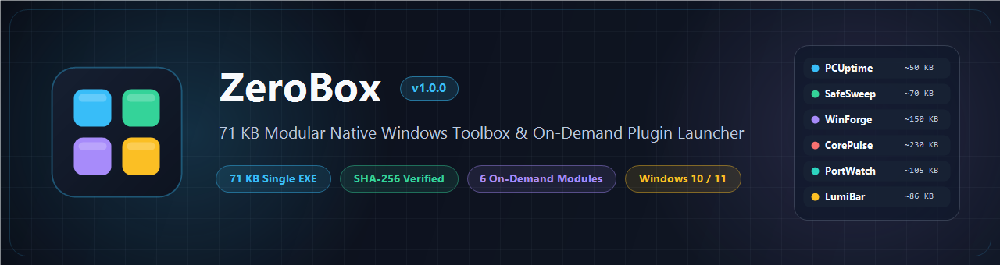
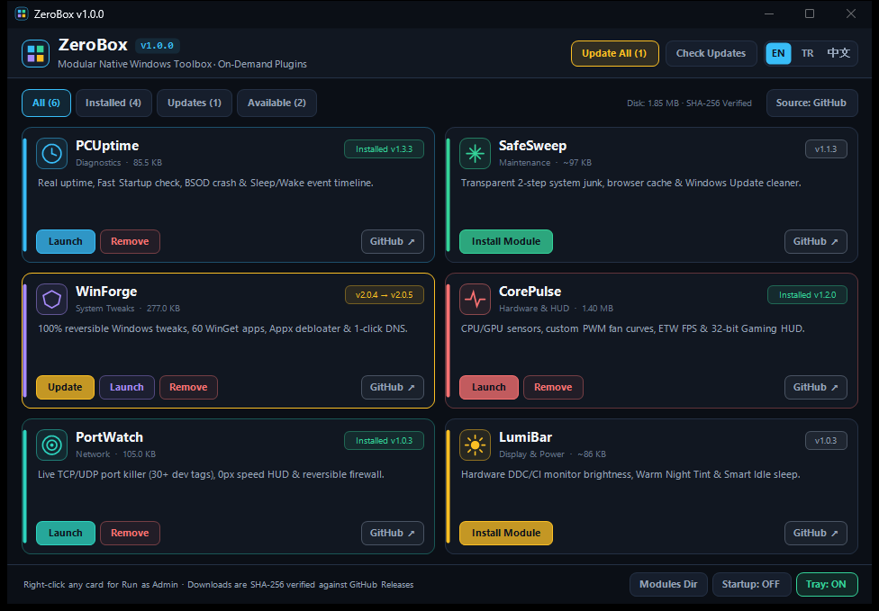

<p align="center">
  
</p>

<p align="center">
  <strong>English</strong> | <a href="README.zh-CN.md">简体中文</a>
</p>

<p align="center">
  <a href="https://github.com/rodvay/ZeroBox/releases/latest"></a>
  
  
  
  <a href="LICENSE"></a>
  <a href="https://linux.do"></a>
</p>

---

**ZeroBox** is an ultra-lightweight (**~71 KB**), single-file native Windows 10/11 **modular toolbox & on-demand plugin launcher** for the [**@rodvay**](https://github.com/rodvay) Zero-Bloat Windows Suite.

Instead of downloading and manually updating 6 separate utilities, drop a single **71 KB** `ZeroBox.exe` anywhere on your PC and install, update, launch, or cleanly remove only the native micro-apps you actually want — zero bundled bloat, zero background telemetry, and strict **SHA-256 verification** on every module download.

## Screenshot

<p align="center">
  
</p>

## Available Official Modules (On-Demand)

| Module | Category | Size | What It Does | Repository |
| :--- | :--- | :---: | :--- | :--- |
| **PCUptime** | System | `~50 KB` | Real uptime, Fast Startup detection, BSOD crash & Sleep/Wake event timeline | [rodvay/PCUptime](https://github.com/rodvay/PCUptime) |
| **SafeSweep** | Maintenance | `~70 KB` | Transparent 2-step system junk, browser cache & Windows Update cleaner | [rodvay/SafeSweep](https://github.com/rodvay/SafeSweep) |
| **WinForge** | System | `~150 KB` | Reversible Windows 10/11 privacy/performance optimizer, AppX debloater & Winget manager | [rodvay/WinForge](https://github.com/rodvay/WinForge) |
| **CorePulse** | Hardware | `~230 KB` | Live CPU/GPU/RAM sensors, custom PWM fan curves & 32-bit Gaming HUD | [rodvay/CorePulse](https://github.com/rodvay/CorePulse) |
| **PortWatch** | Network | `~105 KB` | Live TCP/UDP port killer (30+ dev/proxy tags), `0px` Mini Speed HUD & reversible firewall | [rodvay/PortWatch](https://github.com/rodvay/PortWatch) |
| **LumiBar** | Display | `~86 KB` | Hardware DDC/CI multi-monitor brightness & contrast, Warm Night Tint & Smart Idle sleep | [rodvay/LumiBar](https://github.com/rodvay/LumiBar) |

## Key Features

- **100% On-Demand Modular Architecture:** ZeroBox itself is only **~71 KB** and ships with zero pre-bundled payloads. Each micro-app is downloaded directly from its official GitHub Release only when you click **Install**, and lives cleanly inside `%LOCALAPPDATA%\ZeroBox\modules\<ModuleId>\`.
- **Strict SHA-256 Integrity + Zip-Slip Protection:** Verifies every downloaded `.exe` or portable `.zip` against GitHub's official `SHA-256` release digest before installing, blocks running-process file lock collisions, and enforces strict Zip-Slip path containment during archive extraction.
- **Direct GitHub + Optional Mirror (`gh-proxy.org`) Toggle:** Queries the official GitHub Releases API (with automatic non-rate-limited `/releases/latest` 302 redirect fallback if API quota is exhausted) and provides a 1-click **Source: GitHub / Mirror** toggle for smooth downloads in restricted network environments.
- **1-Click `Update All`, Launch as Admin & Clean Uninstall:** Check all modules in parallel, batch-update outdated tools with one click, right-click any installed card for **Launch as Administrator** or **Open Folder**, or **Remove** any plugin cleanly without leaving registry clutter.
- **Unified Single System Tray & Keyboard Shortcuts:** Minimize ZeroBox to one lightweight tray icon listing all your installed modules for instant 1-click launch. Supports `F5` (check updates), `Ctrl+1..6` (instant module launch), `Start with Windows`, Per-Monitor V2 DPI, Single-Instance Mutex, and trilingual UI (`English / Türkçe / 简体中文`).

## Download & Run

1. Download **`ZeroBox.exe`** from [GitHub Releases](https://github.com/rodvay/ZeroBox/releases/latest).
2. Double-click to run — **no installer, no admin privileges required** to manage modules.
3. Click **Install** on any module card you want, or right-click an installed card for quick actions.

### Build from Source (Zero External SDK Required)

```powershell
.\build.ps1
```

## Türkçe Özet

**ZeroBox**, Windows 10/11 için yalnızca **~71 KB** boyutunda, tek dosya yerel **Modüler Araç Kutusu ve İsteğe Bağlı Eklenti Başlatıcısıdır**:
- [@rodvay](https://github.com/rodvay) serisindeki 6 bağımsız mikro uygulamayı (**PCUptime, SafeSweep, WinForge, CorePulse, PortWatch, LumiBar**) tek bir modern koyu arayüzde toplar; yalnızca ihtiyacınız olan modülleri tek tıkla kurar, günceller veya temizce kaldırır.
- İndirilen her modülü GitHub'ın resmi **SHA-256** özetiyle doğrular, ZIP arşivlerini Zip-Slip korumasıyla açar ve tüm kurulu araçları tek bir **Sistem Tepsisi** menüsünden anında başlatmanızı sağlar.

## Community & Links

- Inspired by community feedback on **[LINUX DO](https://linux.do)** — Thank you to `莫乃 monater` and the entire LINUX DO open-source community for the modular toolbox idea and support!

## License

[MIT License](LICENSE) © 2026 [rodvay](https://github.com/rodvay)
