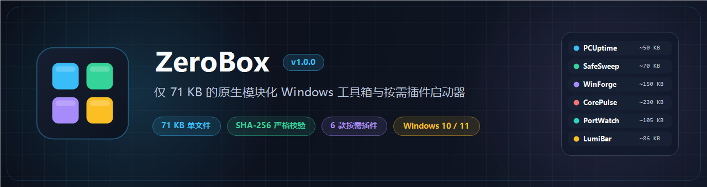
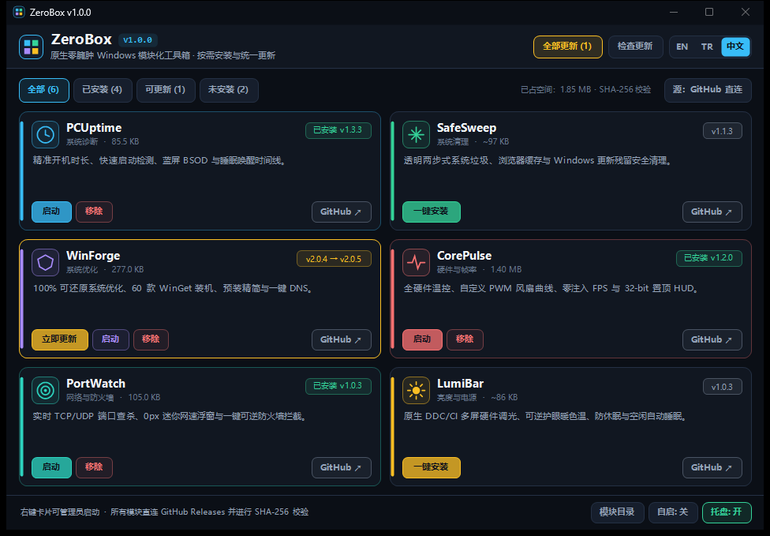

<p align="center">
  
</p>

<p align="center">
  <a href="README.md">English</a> | <strong>简体中文</strong>
</p>

<p align="center">
  <a href="https://github.com/rodvay/ZeroBox/releases/latest"></a>
  
  
  
  <a href="LICENSE"></a>
  <a href="https://linux.do"></a>
</p>

---

**ZeroBox** 是一款仅 **~71 KB** 的原生单文件 Windows 10/11 **模块化工具箱与按需插件启动器**，专为 [**@rodvay**](https://github.com/rodvay) 零臃肿开源工具全家桶打造！

无需再一个个手动下载、分散存放和逐个检查更新：只需一个 **71 KB** 的 `ZeroBox.exe`，按需一键安装、更新、启动或彻底卸载你真正需要的原生小工具 —— **绝不预装捆绑任何多余组件，零后台遥测，每次下载严格校验 SHA-256**。

## 界面预览

<p align="center">
  
</p>

## 内置官方模块目录（按需下载）

| 模块 | 分类 | 体积 | 核心功能 | 开源仓库 |
| :--- | :--- | :---: | :--- | :--- |
| **PCUptime** | 系统诊断 | `~50 KB` | 真实运行时间、快速启动识别、蓝屏崩溃与休眠唤醒事件线 | [rodvay/PCUptime](https://github.com/rodvay/PCUptime) |
| **SafeSweep** | 清理维护 | `~70 KB` | 透明两步预览式系统垃圾、浏览器缓存与 Windows 更新清理 | [rodvay/SafeSweep](https://github.com/rodvay/SafeSweep) |
| **WinForge** | 系统优化 | `~150 KB` | 可逆 Windows 10/11 隐私/性能优化、AppX 精简与 Winget 管理 | [rodvay/WinForge](https://github.com/rodvay/WinForge) |
| **CorePulse** | 硬件监控 | `~230 KB` | CPU/GPU/内存实时传感器、PWM 风扇曲线与 32-bit 游戏顶栏 HUD | [rodvay/CorePulse](https://github.com/rodvay/CorePulse) |
| **PortWatch** | 网络工具 | `~105 KB` | 实时 TCP/UDP 端口查杀（30+ 开发/代理标签）、顶栏网速与可逆防火墙 | [rodvay/PortWatch](https://github.com/rodvay/PortWatch) |
| **LumiBar** | 显示电源 | `~86 KB` | DDC/CI 多显示器硬件亮度/对比度、护眼暖色温、防休眠与智能空闲关机 | [rodvay/LumiBar](https://github.com/rodvay/LumiBar) |

## 核心特性

- **真正按需加载的模块化架构：** ZeroBox 本体仅 **~71 KB**，不捆绑任何工具本体；点击「安装」才直接从官方 GitHub Releases 拉取对应模块，并整洁存放在 `%LOCALAPPDATA%\ZeroBox\modules\<模块名>\`。
- **严格 SHA-256 哈希校验 + Zip-Slip 防护：** 每次下载 `.exe` 或便携 `.zip`（如 CorePulse）均与 GitHub 官方发布的 `SHA-256` 摘要严格比对，不一致立即中止；解压内置路径穿越（Zip-Slip）防护，且更新/卸载前自动检测进程占用。
- **GitHub 直连 + 一键镜像加速 (`gh-proxy.org`)：** 自动请求 GitHub Releases API（遇到 API 限流自动无缝回退至 `/releases/latest` 重定向解析，永不卡死），顶栏提供一键 **GitHub / 镜像源** 切换，国内网络同样丝滑拉取。
- **一键「全部更新」、管理员启动与无痕卸载：** 并行检测所有模块最新版本，支持一键批量更新；右键已安装卡片可直接「以管理员身份运行」或「打开所在目录」，卸载直接清理模块目录不留垃圾。
- **统一系统托盘 + 快捷键 + 三语原生高分屏：** 最小化后只占 **1 个轻量系统托盘图标**，右键菜单列出所有已装模块一键秒开；内置 `F5` 检查更新、`Ctrl+1..6` 快捷启动、开机自启、Per-Monitor V2 高分屏适配、单实例互斥与 **简体中文 / English / Türkçe** 自动语言切换。

## 下载与使用

1. 前往 [GitHub Releases](https://github.com/rodvay/ZeroBox/releases/latest) 下载 **`ZeroBox.exe`**。
2. 绿色免安装、无需管理员权限，双击即可运行。
3. 点击所需模块卡片的 **「安装」** 按钮按需拉取，安装后即可直接启动或从托盘秒开。

### 本地零依赖编译

```powershell
.\build.ps1
```

## 社区与友情链接

- 本项目灵感源自 **[LINUX DO](https://linux.do)** 社区的开源讨论与建议 —— 特别感谢 `莫乃 monater` 以及各位佬友提出“模块化插件工具箱”的绝妙点子与一直以来的支持！

## 开源协议

[MIT License](LICENSE) © 2026 [rodvay](https://github.com/rodvay)
